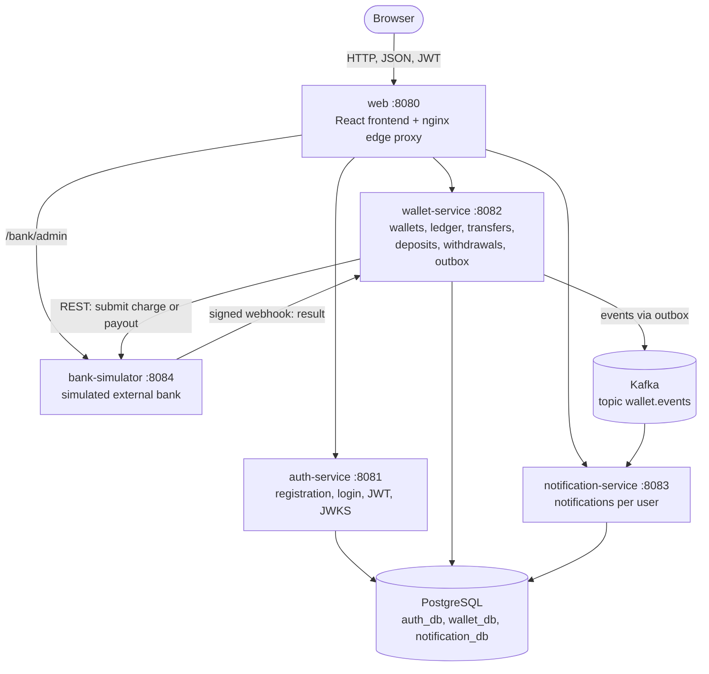
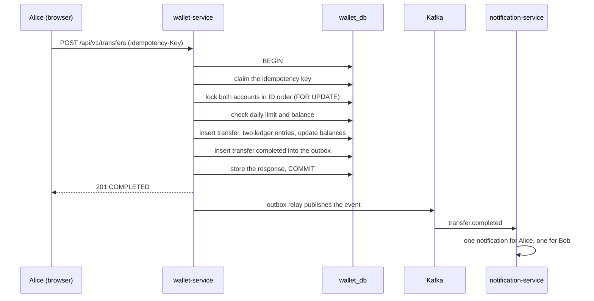
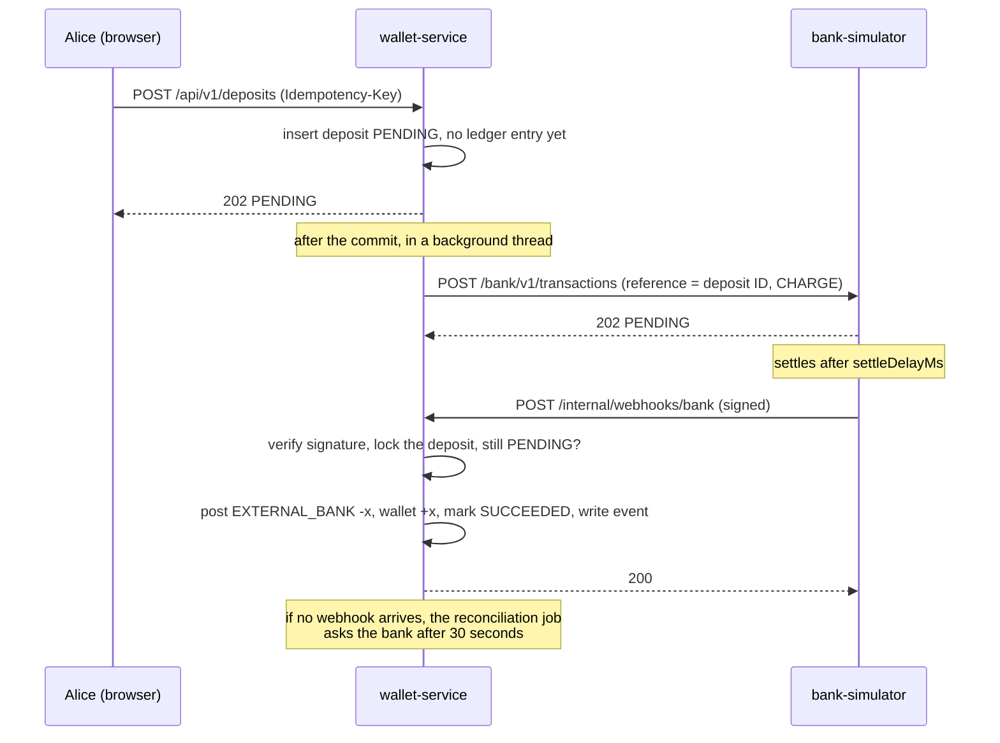

# Digital Wallet Platform

A digital wallet built as Spring Boot microservices with a React web frontend (branded **Tally**). A customer registers, opens a wallet, adds money from a bank account, sends money to other customers, withdraws money back to the bank, and receives a notification for every movement.

The bank is an external system that is slow, fails, and repeats its callbacks. Every balance stays correct in spite of that: under concurrent requests, failures of the bank or of Kafka, duplicate webhooks, and service restarts.

The project implements the **full level** of the requirements specification: every baseline requirement, every full-level requirement, and all 17 automated acceptance scenarios of Section 11.2.

---

## Contents

1. [Quick start](#quick-start)
2. [What the wallet does](#what-the-wallet-does)
3. [Architecture](#architecture)
4. [How money moves](#how-money-moves)
5. [The ledger](#the-ledger)
6. [Baseline level: scenarios B1 to B7](#baseline-level-scenarios-b1-to-b7)
7. [Full level: what it adds](#full-level-what-it-adds)
8. [Automated acceptance tests 1 to 17](#automated-acceptance-tests-1-to-17)
9. [Observability](#observability)
10. [API overview](#api-overview)
11. [Repository layout](#repository-layout)
12. [Operations cheat sheet](#operations-cheat-sheet)

---

## Quick start

Requirements: Docker Desktop. Nothing else needs to be installed; every service, including the React frontend, is built inside Docker.

```bash
cp .env.example .env
docker compose up --build
```

The first build takes several minutes. When `docker compose ps` shows all **10 containers** as `healthy`, open:

| What | URL |
|---|---|
| The application | http://localhost:8080 |
| Grafana dashboard | http://localhost:3000 |
| Zipkin traces | http://localhost:9411 |
| Prometheus | http://localhost:9090 |
| API documentation (Swagger UI) | http://localhost:8080/docs/wallet/swagger-ui.html (switch between the four services in the top-right menu) |

An administrator is created at startup from `ADMIN_USERNAME` and `ADMIN_PASSWORD` in `.env` (by default `admin` / `change-me-admin-password`). Customers register themselves on the login page.

---

## What the wallet does

| For customers | For administrators |
|---|---|
| Sign up and log in | Check the six ledger invariants with one click |
| Open a wallet and see the balance, the amount reserved by pending withdrawals, and the amount sent today against the daily limit | See pending deposits and withdrawals, the outbox backlog, and the state of the bank circuit breaker, refreshed every 2 seconds |
| Add money from the bank, with a live progress view until the bank confirms | List all wallets with their balances |
| Send money to anyone by username, with a note | Start a reconciliation run with the bank at once |
| Withdraw money to the bank | Switch bank failures on and off: slow, down, hanging, declining, duplicate or missing webhooks |
| Read the statement with running balances, filtered by type, page by page | Repeat the last money request with the same idempotency key, or send it 10 times in parallel, and see that it runs once |
| Get a notification for every movement, mark one or all as read | Open the Swagger UI of every service, Grafana and Zipkin |

Business rules (Section 4 of the specification):

- One currency, USD. Every amount is an integer number of **cents** in the API, in events and in the database.
- A transfer, deposit or withdrawal is between 1 and 200,000 cents.
- A wallet sends at most 500,000 cents per UTC day (transfers sent plus withdrawals requested; a failed withdrawal no longer counts).
- Transfers are synchronous and final. Deposits and withdrawals are asynchronous: `PENDING`, then `SUCCEEDED` or `FAILED` when the bank reports the result.

---

## Architecture

Five microservices, each owning its own data, plus five infrastructure containers.



| Service | Responsibility | Data it owns |
|---|---|---|
| **auth-service** | Registration, login, RS256 JWTs valid for 30 minutes, the public keys as a JWKS document, login rate limiting | Users and BCrypt password hashes |
| **wallet-service** | Wallets, double-entry ledger, transfers, deposits, withdrawals, idempotency, outbox, reconciliation with the bank, admin API | Wallets, ledger entries, transfers, deposits, withdrawals, idempotency records, outbox |
| **notification-service** | Consumes `wallet.events`, creates the notifications, ignores duplicates, dead-letters unreadable messages | Notifications, IDs of processed events |
| **bank-simulator** | Accepts charges and payouts, settles them later, sends signed webhooks, produces failures on request | Bank transactions (in memory) |
| **web** | Serves the React single-page app and routes `/api/v1/**`, `/bank/admin/**` and `/docs/**` to the right service | None |

Infrastructure containers: **PostgreSQL** (one database and one user per service), **Kafka** (KRaft, 3 partitions), **Prometheus**, **Grafana**, **Zipkin**.

How the services talk to each other:

- The browser talks **only** to `web`. The `/internal/**` webhook endpoint, `/bank/v1/**`, the JWKS document and all actuator endpoints are reachable only inside the Docker network.
- wallet-service and notification-service validate tokens **locally** with the public keys from auth-service's JWKS endpoint; they never call auth-service per request.
- wallet-service calls the bank over REST and the bank answers with **signed webhooks** (HMAC-SHA256 of `timestamp.body`).
- wallet-service never calls notification-service. It writes events to an **outbox** table, and a relay publishes them to Kafka.

### Technology

| Area | Used |
|---|---|
| Language and framework | Java 21, Spring Boot 3.5, Maven |
| Persistence | PostgreSQL 16, Spring JDBC (`JdbcClient`) in wallet and notification, Spring Data JPA in auth, Flyway migrations |
| Messaging | Apache Kafka with Spring for Apache Kafka |
| Security | Spring Security; wallet and notification are OAuth 2.0 resource servers |
| Resilience | Resilience4j retry with exponential backoff and jitter, circuit breaker |
| API documentation | springdoc-openapi |
| Observability | Actuator, Micrometer, Prometheus, Grafana, OpenTelemetry tracing to Zipkin |
| Frontend | React 19, bundled with esbuild, served by unprivileged nginx |
| Tests | JUnit 5, Testcontainers (PostgreSQL and Kafka), Awaitility |
| Delivery | Docker, Docker Compose |

---

## How money moves

### A transfer: synchronous, one database transaction



### A deposit: asynchronous, finished by the bank



A withdrawal works the same way, except that the amount is **reserved** at once (wallet to `PAYOUT_HOLD`) in the transaction that creates it. When the bank confirms, the hold moves to `EXTERNAL_BANK`; when the bank declines, it goes back to the wallet as a `WITHDRAWAL_REVERSAL`.

---

## The ledger

A balance changes **only** through ledger entries, and an entry is never updated or deleted (a database trigger enforces it). There is one account per wallet and two system accounts: `EXTERNAL_BANK` (money that came from or went to the bank) and `PAYOUT_HOLD` (money reserved for withdrawals in progress).

Every business event is posted as a group of entries that add up to zero:

| Business event | Entries |
|---|---|
| Transfer of x from A to B | A −x, B +x |
| Deposit of x succeeds | EXTERNAL_BANK −x, wallet +x |
| Withdrawal of x requested | wallet −x, PAYOUT_HOLD +x |
| Withdrawal succeeds | PAYOUT_HOLD −x, EXTERNAL_BANK +x |
| Withdrawal fails | PAYOUT_HOLD −x, wallet +x |

The admin integrity check verifies six invariants in one consistent snapshot (a read-only `REPEATABLE READ` transaction):

| Invariant | Meaning |
|---|---|
| INV-1 | All entries add up to zero, and so does every posting |
| INV-2 | The balance of every account equals the sum of its entries |
| INV-3 | No wallet balance is negative, and `PAYOUT_HOLD` is not negative |
| INV-4 | `PAYOUT_HOLD` equals the sum of all pending withdrawals |
| INV-5 | `EXTERNAL_BANK` equals succeeded withdrawals minus succeeded deposits |
| INV-6 | Within a wallet, each `balanceAfter` equals the previous one plus the entry's amount |

---

## Baseline level: scenarios B1 to B7

The baseline is the minimum acceptable delivery: every service starts, the services communicate over all interfaces, and the platform works end to end through the frontend under nominal conditions (database, Kafka and bank available; the bank approves everything and sends each webhook once).

| # | Scenario | Expected result | How to show it |
|---|---|---|---|
| B1 | The system is started | Every container becomes healthy without a manual step | `docker compose up --build`, then `docker compose ps` |
| B2 | Alice and Bob sign up, log in and open their wallets | Each has one wallet with $0.00 | Two browser windows (one private), sign up, **Open my wallet** |
| B3 | Alice adds $100.00 | PENDING, then SUCCEEDED; balance $100.00; a DEPOSIT entry; one notification | **Add money** → 100; the progress view moves from "Waiting for the bank" to complete |
| B4 | Alice sends Bob $12.50 with a note | Alice $87.50, Bob $12.50; both statements show the transfer, note and balance after; each gets a notification | **Send** → bob → 12.50, "Lunch"; Bob's notification appears without a reload |
| B5 | Alice withdraws $20.00 | PENDING with $20.00 reserved, then SUCCEEDED; balance $67.50; two new notifications | **Withdraw** → 20 |
| B6 | Alice sends more than her balance, sends to her own username, and looks up an unknown username | The messages for INSUFFICIENT_FUNDS, SAME_WALLET and WALLET_NOT_FOUND; no balance changes | **Send** with 1000, with `alice`, with `nobody` |
| B7 | `GET /api/v1/wallets/me` without a token, and Bob requests Alice's deposit by its ID | 401 UNAUTHENTICATED and 404 NOT_FOUND | `bash demo-b7.sh` (prints 401, 404, and 200 for Alice herself) |

B7 by hand:

```bash
curl -i localhost:8080/api/v1/wallets/me                                   # 401

login() { curl -s -X POST localhost:8080/api/v1/auth/login -H 'Content-Type: application/json' \
  -d "{\"username\":\"$1\",\"password\":\"correct-horse-battery\"}" | python3 -c 'import sys,json; print(json.load(sys.stdin)["accessToken"])'; }
ALICE=$(login alice); BOB=$(login bob)
DEP=$(curl -s "localhost:8080/api/v1/deposits?limit=1" -H "Authorization: Bearer $ALICE" \
  | python3 -c 'import sys,json; print(json.load(sys.stdin)["items"][0]["id"])')
curl -i localhost:8080/api/v1/deposits/$DEP -H "Authorization: Bearer $BOB"    # 404
curl -i localhost:8080/api/v1/deposits/$DEP -H "Authorization: Bearer $ALICE"  # 200
```

---

## Full level: what it adds

The full level is every requirement of the specification. On top of the baseline, the system stays correct under concurrent requests, failures of its dependencies and restarts, and meets all security and operations requirements.

| Area | What is implemented | Requirements |
|---|---|---|
| **Concurrency** | Balance check and change in one transaction with row locks taken in account-ID order, so concurrent transfers cannot overspend and opposite transfers cannot deadlock; a deadlock or serialization failure is retried automatically (up to 5 times); database constraints for one wallet per user, one record per idempotency key, and non-negative balances | CON-1 to CON-6 |
| **Idempotency** | `Idempotency-Key` required on every money request; the key, the operation and the stored response are written in one transaction; a repeat returns the stored response with `Idempotent-Replayed: true`; a different body gives 422; a concurrent repeat waits or gets 409 | IDM-1 to IDM-7 |
| **Bank integration** | Bank calls never inside a transaction and never while the customer waits; response timeout, bounded retries with exponential backoff and jitter, circuit breaker; a timeout means "unknown", never "failed"; the result is applied exactly once from webhooks, copies of webhooks, or reconciliation; a reconciliation job finishes anything pending for more than 30 seconds, also after a restart; signed webhooks with a 5-minute window | RES-1 to RES-9 |
| **Events** | Outbox written in the same transaction as the change; at-least-once delivery, in order per aggregate, 3 partitions; Kafka outages do not slow the API; consumers ignore duplicates, unknown types and unknown versions | EVT-1 to EVT-5 |
| **Notifications** | Each event creates each notification once however often it is delivered; unreadable messages go to `wallet.events.dlt` and the consumer continues; counters for processed, duplicate and dead-lettered events | NTF-2, NTF-4, NTF-5 |
| **Administration** | Integrity check of INV-1 to INV-6 from one snapshot, status, all wallets, reconciliation on demand, and the admin console with bank presets and diagnostics | ADM-1 to ADM-4, UI-3 |
| **Security** | Admin endpoints require ADMIN; the bank authenticates its webhooks and wallet-service authenticates to the bank with an API key; at most 5 login attempts per username per minute (429 with `Retry-After`) | SEC-3, SEC-4, SEC-9, AUTH-6 |
| **Operations** | Structured JSON logs with service name, trace ID, span ID and user ID; Prometheus metrics including business metrics; W3C trace context across services, traces in Zipkin; a provisioned Grafana dashboard; graceful shutdown; every image runs as a non-root user | OPS-4 to OPS-9 |
| **Automated tests** | All 17 scenarios of Section 11.2, against real PostgreSQL and Kafka | ACC-2 |

---

## Automated acceptance tests 1 to 17

The tests start their own PostgreSQL and Kafka containers with **Testcontainers**, so they never touch the data of `docker compose`. In wallet-service tests, a small fake bank (`FakeBank`) plays the bank and serves the JWKS document; tokens are signed in the test with the same RS256 mechanism as auth-service. Timeouts are shortened for speed (bank timeout 1 s, reconciliation after 2 s, circuit breaker opens for 2 s); the logic is the same.

| # | Scenario | How the test does it | Requirements |
|---|---|---|---|
| 1 | 32 threads, 2,000 random transfers among 10 wallets, including opposite directions | 10 wallets with $1,000 each; 2,000 transfers on 32 threads, 400 of them back and forth between the same two wallets; only 201 or 422 INSUFFICIENT_FUNDS allowed; total money unchanged; integrity check passes | CON-1, CON-3 |
| 2 | 10,000 cents, 20 concurrent transfers of 1,000 | All 20 released at the same moment with a latch; exactly 10 succeed, 10 get INSUFFICIENT_FUNDS; balance 0 | CON-2 |
| 3 | The same transfer with the same key 10 times at once | Every response is the stored 201 or 409 REQUEST_IN_PROGRESS; exactly one transfer ID; one TRANSFER_OUT entry | IDM-2, IDM-6 |
| 4 | A stored key sent again with a different amount | 422 IDEMPOTENCY_KEY_REUSED; one transfer | IDM-5 |
| 5 | The response is lost and the client repeats the request | The repeat returns the same transfer ID with `Idempotent-Replayed: true`; one transfer | IDM-4 |
| 6 | Transfers exceeding the daily limit, sequential and concurrent | 200,000 + 200,000 + 100,000 succeed, the next cent is rejected; another user sends 10 × 100,000 at once and exactly 5 succeed; `sentToday` is 500,000 | MNY-3 |
| 7 | User A requests B's transfer, deposit, withdrawal and notification | 404 NOT_FOUND every time, while the owner gets 200 (the notification part is in notification-service) | API-4 |
| 8 | Paging a statement while entries are posted | Pages of 3 while another thread keeps transferring; no entry twice, no earlier entry missing | API-5 |
| 9 | The webhook of a succeeded deposit arrives three times | The fake bank sends three copies at the same moment; balance credited once, one DEPOSIT entry | RES-6, DEP-3 |
| 10 | A wrong signature and a 10-minute-old timestamp | Both 401 INVALID_SIGNATURE; the deposit stays PENDING, balance 0 | RES-9 |
| 11 | The bank creates a payout, holds back the response and sends no webhook | After the client timeout the money is still reserved, not released; reconciliation finishes it as SUCCEEDED | RES-4, RES-7 |
| 12 | A webhook and reconciliation apply the same result at the same moment | 5 webhooks and 5 direct reconciliation calls in parallel; applied once | RES-6 |
| 13 | Three withdrawals while the bank is down, then it returns | Each answered with 202 in under a second; all three become SUCCEEDED after the bank is back; integrity passes | RES-1, RES-3 |
| 14 | The bank declines a payout | FAILED; money back; one WITHDRAWAL_REVERSAL; `sentToday` no longer includes it | WDR-3, MNY-3 |
| 15 | Transfers while Kafka is unavailable, then Kafka returns | The Kafka container is **paused**; transfers still succeed in under 2 seconds; after it resumes, every transfer's event is on `wallet.events` | EVT-1, EVT-3 |
| 16 | The same event delivered twice | One notification per recipient, with the exact texts of the specification | NTF-2 |
| 17 | An unparseable message followed by valid events | The message is on `wallet.events.dlt` with its key and value; the valid event is processed | NTF-4 |

Run them (Docker Desktop must be running; stopping `docker compose` first frees memory):

- In IntelliJ: open `wallet-service/src/test/java/com/example/wallet/acceptance/WalletAcceptanceTest.java` (scenarios 1 to 15) and `notification-service/src/test/java/com/example/notification/acceptance/NotificationAcceptanceTest.java` (7, 16 and 17), and run the class.
- `src/test/resources/docker-java.properties` sets `api.version=1.44`, which recent Docker Desktop versions require.

---

## Observability

| Tool | What it shows | How to use it |
|---|---|---|
| **Grafana** (http://localhost:3000) | One provisioned dashboard: bank circuit breaker, pending operations, outbox backlog, request rate, error rate, p95 latency, operations by result, calls to the bank, notification events | Switch the bank to **Down** in the admin console and watch the circuit turn red and pending operations rise |
| **Prometheus** (http://localhost:9090) | The time-series database behind Grafana; scrapes every service every 5 seconds | `/targets` shows the four services; query for example `wallet_bank_circuit_state` |
| **Zipkin** (http://localhost:9411) | One trace per request across services | Filter `serviceName = bank-simulator`, `spanName = http post`: a webhook trace with the bank's span and wallet-service's span |
| **Logs** | One JSON object per line with service name, trace ID, span ID and user ID | `docker compose logs wallet-service --tail 20` |

Every error response carries the `traceId` of its request, so a reported error can be found in Zipkin and in the logs.

---

## API overview

All endpoints are under `/api/v1` on port 8080 and need `Authorization: Bearer <token>` except registration and login. Errors are `application/problem+json` (RFC 9457) with `code` and `traceId`. Full documentation is in the Swagger UI.

| Service | Endpoints |
|---|---|
| auth | `POST /auth/register`, `POST /auth/login`, `GET /auth/me` |
| wallet | `POST /wallets`, `GET /wallets/me`, `GET /wallets/lookup?username=`, `GET /wallets/me/entries` |
| | `POST /transfers`, `GET /transfers/{id}` |
| | `POST /deposits`, `GET /deposits`, `GET /deposits/{id}` |
| | `POST /withdrawals`, `GET /withdrawals`, `GET /withdrawals/{id}` |
| wallet admin | `GET /admin/integrity`, `GET /admin/status`, `GET /admin/wallets`, `POST /admin/reconciliation` |
| notification | `GET /notifications`, `GET /notifications/unread-count`, `POST /notifications/{id}/read`, `POST /notifications/read-all`, `GET /notifications/admin/stats` |
| bank (admin console) | `GET` and `PUT /bank/admin/config`, `GET /bank/admin/transactions`, `POST /bank/admin/reset` |

Money requests (`POST /transfers`, `/deposits`, `/withdrawals`) require an `Idempotency-Key` header of 1 to 64 characters.

---

## Repository layout

```
digital-wallet/
├── docker-compose.yml          all 10 containers, health checks, startup order
├── .env.example                secrets and settings (copy to .env; .env is never committed)
├── demo-b7.sh                  scenario B7 in one command
├── infra/
│   ├── postgres/               creates one database and one user per service
│   ├── prometheus/             scrape configuration
│   └── grafana/                provisioned data source and dashboard
├── auth-service/               registration, login, JWT, JWKS, login rate limit
├── wallet-service/
│   ├── src/main/java/.../wallet/
│   │   ├── wallet/             wallets, lookup, statement
│   │   ├── transfer/           transfers
│   │   ├── operation/          deposits, withdrawals, bank webhook, reconciliation
│   │   ├── ledger/             the only place where balances change
│   │   ├── idempotency/        Idempotency-Key handling
│   │   ├── outbox/             outbox and Kafka relay
│   │   ├── bank/               bank client with retry and circuit breaker, webhook signature
│   │   ├── admin/              integrity, status, wallets
│   │   └── metrics/            business metrics
│   ├── src/main/resources/db/migration/   Flyway migrations V1 to V4
│   └── src/test/java/.../acceptance/      acceptance tests 1 to 15
├── notification-service/       Kafka consumer, notifications, dead-letter topic; tests 7, 16, 17
├── bank-simulator/             the simulated bank and its failure settings
└── web/                        React frontend (src/), esbuild build, nginx edge proxy
```

---

## Operations cheat sheet

| Task | Command |
|---|---|
| Start everything (first time or after a code change) | `docker compose up -d --build` |
| Check health | `docker compose ps` |
| Pause, keeping data | `docker compose stop`, later `docker compose start` |
| Stop and remove containers, keeping data | `docker compose down` |
| Reset all data | `docker compose down -v && docker compose up -d` |
| Rebuild only the frontend | `docker compose up -d --build web` |
| Follow a service's logs | `docker compose logs -f wallet-service` |
| Check the ledger adds up to zero | `docker compose exec -T postgres psql -U wallet_user -d wallet_db -c "SELECT type, SUM(balance) FROM accounts GROUP BY type;"` |
| See the events on Kafka | `docker compose exec kafka /opt/kafka/bin/kafka-console-consumer.sh --bootstrap-server localhost:9092 --topic wallet.events --from-beginning --timeout-ms 5000` |
| Put the bank back to normal | Admin console → Bank → **Normal**, or `curl -X PUT localhost:8080/bank/admin/config -H 'Content-Type: application/json' -d '{}'` |
